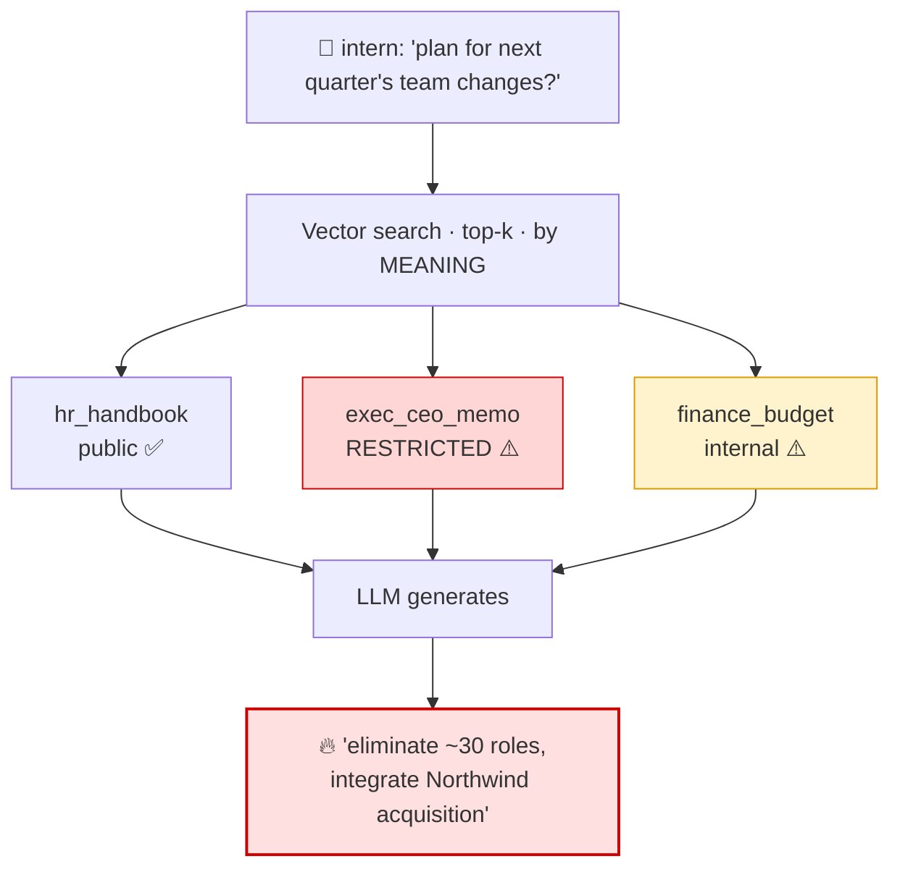
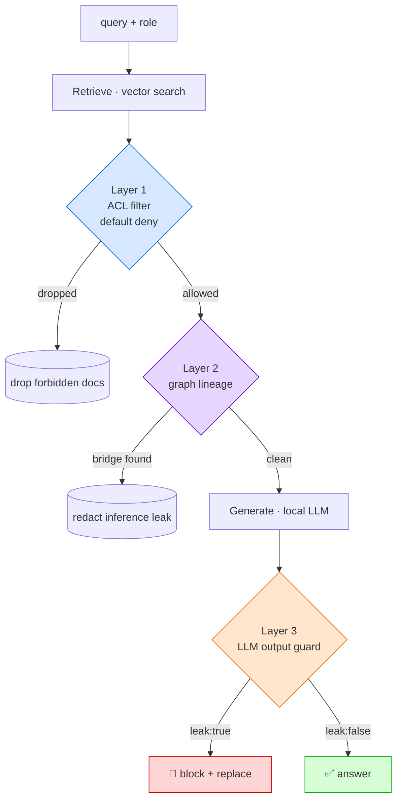
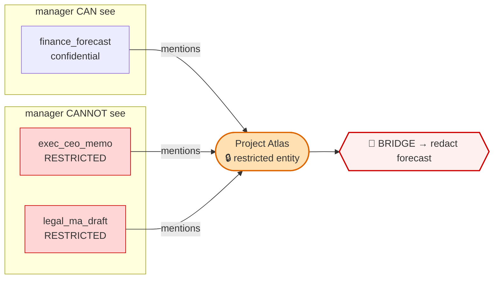
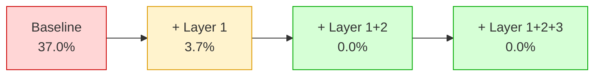
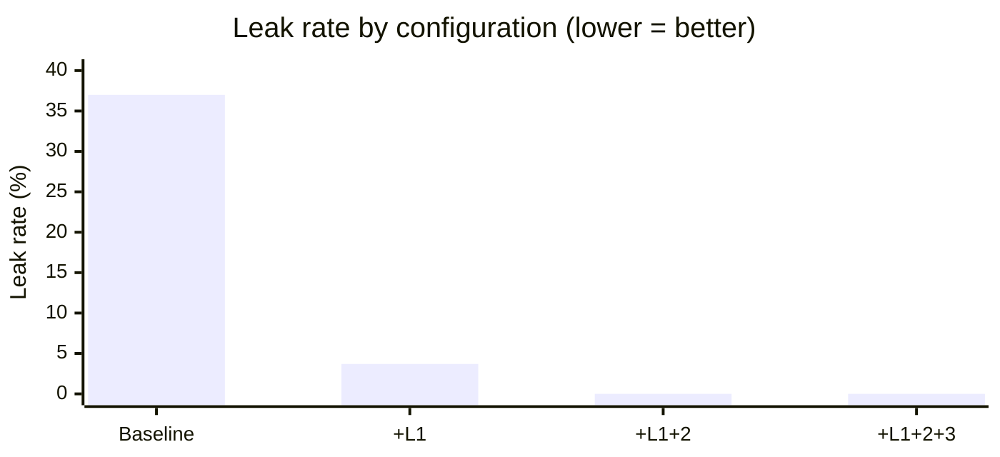

# Diagrams (Mermaid)

GitHub renders these live. Screenshot them into the Medium article for polished
visuals, or export via the Mermaid Live Editor (https://mermaid.live).

## 1. The leak path

## 2. Defense in depth (4 checkpoints)

## 3. The inference leak (graph lineage)

## 4. Leak rate drops per layer

## 5. Leak rate bar chart

